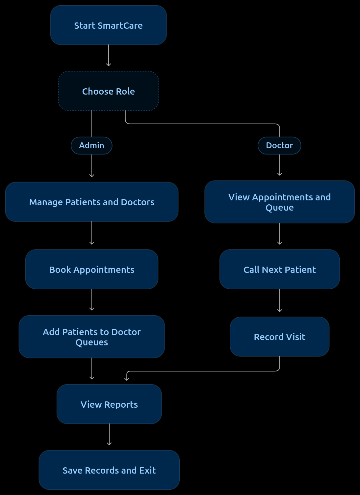

 <div align="center">

# 🏥 SmartCare
### 💙 Hospital Management System

**A Smart, Queue-Driven Hospital Management System built using C++17 and STL**


*Organised records. Smarter queues. Better hospital workflows.*

</div>

---

## 🌟 About SmartCare

**SmartCare** is a menu-driven Hospital Management System developed in **C++17** as a Data Structures and Algorithms Laboratory mini project.

The application brings together patient registration, doctor management, appointment scheduling, doctor-wise patient queues, emergency prioritisation, visit records, and file handling in one modular program.

Instead of using data structures only for theoretical exercises, SmartCare demonstrates how they can solve practical problems in a hospital environment.

> 🎯 **Our mission:** Build a simple, understandable, and functional hospital management prototype while demonstrating the real-world application of Data Structures and Algorithms.

## ✨ Key Features

### 🧑‍⚕️ 1. Patient Management
- Register and display patient records.
- Search patients using their unique Patient ID.
- Update and delete patient records.
- Use a hash-based index for efficient ID lookup.

### 🩺 2. Doctor Management
- Register doctors with a generated Doctor ID, name, specialization, and phone number.
- Display and search doctors.
- Filter doctors by specialization.
- Maintain separate records for each doctor.

### 📅 3. Appointment Scheduling
- Book appointments using Patient ID and Doctor ID.
- Validate patient and doctor IDs before booking.
- Prevent duplicate bookings for the same doctor, date, and time.
- View all appointments or a specific doctor's schedule.

### 🚦 4. Doctor-Wise Patient Queues
- Maintain an independent queue for each doctor.
- Serve regular patients using **FIFO (First In, First Out)**.
- Prioritise emergency patients using a **priority queue**.
- Use arrival order to break equal-priority ties, where supported by the implementation.
- Display estimated waiting times based on an assumed consultation duration.

### 🖥️ 5. Doctor Dashboard
- Enter the Doctor role using a registered Doctor ID.
- View the doctor's appointments.
- View the doctor's own patient queue and waiting-time estimates.
- Call the next patient.
- Record a visit note after the consultation.

### 📊 6. Reports and File Handling
- Sort patient records by name.
- View a hospital summary.
- Display visit history.
- Save and reload patient, doctor, appointment, and visit records using text files.

## 🧠 Data Structures & Algorithms Used

| Data Structure / Concept | Application in SmartCare |
|---|---|
| `vector` | Stores patient, doctor, appointment, and visit records |
| `unordered_map` | Maps record IDs to positions in vectors for fast average-case lookup |
| `queue` | Maintains FIFO order for regular patients |
| `priority_queue` | Selects emergency patients according to priority |
| Sorting | Arranges patient records by name |
| Searching | Retrieves records using IDs and doctor specializations |
| File Handling | Persists records between program executions |

### ⏱️ Time Complexity Overview

| Operation | Typical Complexity |
|---|---|
| Hash-table lookup | Average **O(1)**; worst case **O(n)** |
| Enqueue / dequeue regular patient | **O(1)** |
| Insert / remove from priority queue | **O(log q)** |
| Sort `n` patients | **O(n log n)** |
| Check appointment time conflicts | **O(a)** |

Here, `n` represents the number of records, `q` the number of patients in a priority queue, and `a` the number of appointments.

*Note: These are standard expected complexities for the corresponding data structures. Actual performance depends on the implementation and input data.*

## 🏗️ Project Architecture

SmartCare follows a simple modular architecture to keep the implementation readable and easy to demonstrate.

```text
                 ┌──────────────────────┐
                 │       main.cpp       │
                 │  Program Entry Point │
                 └──────────┬───────────┘
                            │
                 ┌──────────▼───────────┐
                 │     hospital.cpp     │
                 │  Hospital Operations │
                 └──────┬────────┬──────┘
                        │        │
             ┌──────────▼──┐  ┌──▼────────────┐
             │   models.h  │  │  storage.cpp  │
             │ Data Models │  │ Load / Save   │
             └─────────────┘  └──────┬────────┘
                                     │
                              ┌──────▼──────┐
                              │   data/     │
                              │ Text Files  │
                              └─────────────┘
```

### 📂 File Structure

```text
SmartCare/
├── main.cpp                 # Entry point and role selection
├── models.h                 # Patient, Doctor, Appointment, Visit models
├── hospital.h               # Hospital operation declarations
├── hospital.cpp             # Menus, management, queues, and reports
├── storage.h                # Storage function declarations
├── storage.cpp              # Loading and saving records
├── Makefile                 # Optional build shortcut
├── README.md                # Project documentation
├── .gitignore               # Excludes build output and local data
├── data/
│   └── .gitkeep             # Tracks the empty data directory
└── tests/
    └── manual_test_plan.md  # Manual testing checklist
```


## 🔄 Application Workflow


<div align="center">



**Figure 1: SmartCare — Application Workflow**

</div>


## ⚙️ Getting Started

### 📌 Prerequisites

Before running SmartCare, ensure you have:

- A C++17-compatible compiler such as `g++`.
- A terminal or command-line interface.
- `make` (optional).

### 🚀 1. Clone the Repository

```bash
git clone https://github.com/Shrinidhi1403/hospital-management-system.git
cd hospital-management-system
```

### 🔨 2. Compile the Project

Run this command from the directory containing `main.cpp`:

```bash
g++ -std=c++17 -Wall -Wextra -pedantic main.cpp hospital.cpp storage.cpp -o smartcare
```

### ▶️ 3. Run the Application

On Linux:

```bash
./smartcare
```

Alternatively, if `make` is installed:

```bash
make
./smartcare
```

> 💡 **Tip:** Compile all three `.cpp` files together. Run the program from the project directory so relative paths to the `data/` folder resolve correctly.

## 💾 Data Storage

SmartCare uses text files in the `data/` directory for persistent records.

| File | Purpose |
|---|---|
| `patients.txt` | Patient records |
| `doctors.txt` | Doctor records |
| `appointments.txt` | Appointment records |
| `visits.txt` | Consultation notes and visit history |

These files are generated when the program saves data. The `.gitkeep` file allows Git to track the initially empty `data/` directory.

## 🧪 Testing and Validation

The project includes a manual testing checklist in [`tests/manual_test_plan.md`](tests/manual_test_plan.md).

Recommended test scenarios:

- ✅ Register and search valid patient and doctor IDs.
- ✅ Handle nonexistent patient and doctor IDs.
- ✅ Book an appointment successfully.
- ✅ Reject a duplicate appointment slot.
- ✅ Verify FIFO order for regular patients.
- ✅ Verify emergency priority in the doctor's queue.
- ✅ Confirm that each doctor has an independent queue.
- ✅ Record a visit and verify visit history.
- ✅ Restart the application and check persistent records.
- ✅ Test invalid menu choices and empty queues.

## ⚠️ Scope and Limitations

SmartCare is an **academic prototype** designed for learning and demonstration, not production hospital use.

- 🔐 Doctor ID selection is not secure authentication.
- 💾 Patient, doctor, appointment, and visit records are persisted in text files.
- 🔄 Waiting queues are stored in memory and reset when the application restarts.
- ⏳ Waiting-time estimates assume a 10-minute consultation duration per patient ahead; actual waiting times may differ.
- 🚑 Emergency prioritisation demonstrates a data structure and is not a substitute for clinical triage.
- 📆 Date and time inputs are not fully calendar-validated.
- 🛡️ Real or confidential patient information should not be entered into this prototype.

## 👥 Project Team

| Team Member | Primary Demonstration Area |
|---|---|
| **Shri** | Introduction, architecture, and patient management |
| **Siddhant** | Hashing and patient search |
| **Ekaksh** | Doctor management and appointment scheduling |
| **Arshad** | Doctor dashboard and doctor-wise queues |
| **Chinmay** | File handling, reports, and testing |

## 🎓 Academic Information

- **Course:** Data Structures and Algorithms Laboratory (DSAL)
- **Project Title:** Hospital Management System
- **Implementation Language:** C++17
- **Libraries:** C++ Standard Library (STL)
- **Interface:** Console-based, menu-driven application

---

<div align="center">

### 💙 Built with C++ | Powered by Data Structures | Made for Learning

*SmartCare — demonstrating how fundamental algorithms can support practical systems.*

</div>
